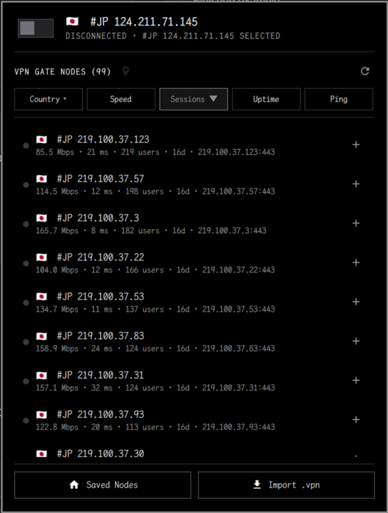
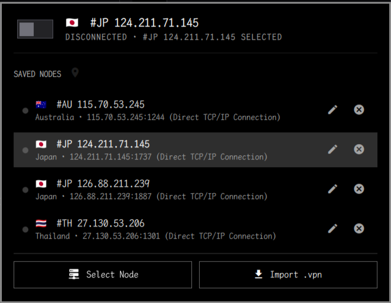

# Omagate

<div style="display: flex; justify-content: space-between; gap: 10px;">
  
  
</div>

Omagate is a native Omarchy bar widget for SoftEther VPN, with first-class
support for [VPN Gate](https://www.vpngate.net/en/) public relay servers as
well as your own imported SoftEther accounts.

It is a renamed and extended fork of
[limbdarkening/omarchy-softether](https://github.com/limbdarkening/omarchy-softether).
Many thanks to LimbDarkening for the original widget and its solid foundation.

Repository: <https://github.com/kanpianer/Omagate>

## Features

- Browse and connect to public VPN Gate relays without importing a profile.
- Left-click the shield, or toggle the connection switch in the panel header, to connect or disconnect the selected account.
- Left-click the flag, or right-click the widget, to choose an imported account.
- Middle-click to refresh the current status.
- Recognizes country names and common aliases anywhere in account names and
  renders the corresponding flag without network lookups.
- Reports the VPN as usable only after SoftEther is connected, the virtual
  adapter has an address, and the adapter owns a default route.
- Turns the connection switch off as soon as the tunnel stops being usable, so a
  link that the server or the network dropped is visible even while the
  SoftEther client still lists the session as connected.
- Protects the VPN server's physical route before making the tunnel the default
  route, preventing the tunnel from trying to carry its own transport.

## Requirements

- Omarchy 4 or later.
- SoftEther VPN Client (`softethervpn` from the AUR) with `vpncmd`.
- NetworkManager and `nmcli`.
- `ip` from `iproute2`, plus the standard `timeout`, `getent`, `flock`, `jq`,
  and coreutils command-line tools included with Omarchy.
- `ca-certificates`, so the VPN Gate directory can be verified over TLS.
- A SoftEther virtual adapter and a matching NetworkManager TAP profile (both
  can be created by the built-in setup below).
- At least one imported account, or an online VPN Gate node.

The default adapter is `vpn_vpn`, and the default NetworkManager profile is
`SoftEther VPN Network`. SoftEther exposes its virtual adapter `<nic>` as a
Linux TAP named `vpn_<nic>`, so the default Linux adapter `vpn_vpn` corresponds
to the SoftEther adapter `vpn`.

Both names can be changed later in the widget settings.

For safety, account and NetworkManager profile names must be 1–128 ASCII
characters, start with a letter or number, and contain only letters, numbers,
single spaces, or `. _ @ ( ) + , # % = -`. Linux adapter names must be 1–15
characters, contain only letters, numbers, `. _ : -`, and start with `vpn_`.

## Installation

```bash
omarchy plugin add https://github.com/kanpianer/Omagate.git --enable
```

The widget appears in the right section of the bar by default.

## First-run setup

Open the widget. If a prerequisite is missing, the panel shows a short checklist
instead of the node list:

1. **Install SoftEther** (only when `vpncmd` is missing) opens a floating
   terminal and runs `omarchy pkg aur add softethervpn`. The AUR build asks for
   your password in that terminal.
2. **Set Up Automatically** runs the local `softether-setup` helper. It
   idempotently:
   - enables and starts `softethervpn-client.service`;
   - creates and enables the SoftEther virtual adapter;
   - adds the NetworkManager TAP profile, unless a profile with that name
     already exists (an existing profile is never overwritten; a mismatched
     interface is reported instead).
3. **Recheck** refreshes the checklist without changing anything.

The plugin polls for the client after the terminal install finishes and then
continues the remaining steps automatically. Nothing is changed until you press
the setup button.

After setup, import a `.vpn` profile or use **Select Node** to connect to a
public VPN Gate node. The plugin does not ship or create a VPN account.

## Privileges

Setup uses the normal Omarchy authentication path:

- `systemctl` and `nmcli` run as your user first. Omarchy's polkit agent
  authorizes the system changes; `pkexec` is only a fallback when direct
  authorization fails.
- The AUR package is built as your user inside the terminal. The plugin never
  runs `sudo` itself.
- The plugin does not install sudoers rules, polkit rules, or setuid helpers,
  and it does not change firewall settings.

The script is intentionally limited to the SoftEther service, one virtual
adapter, and one NetworkManager profile. All steps are safe to repeat.

## Privacy and security

The plugin does not collect telemetry, contact an analytics service, read VPN
profile files, or store credentials. It asks the local SoftEther client for
account status through `vpncmd` and manages the selected connection and routes
through `vpncmd`, `nmcli`, and `ip`.

The optional setup helper invokes the AUR helper, `systemctl`, `vpncmd`, and
`nmcli` only after the user presses the setup button. Those are privileged
capabilities and are documented above; the helper never edits package-manager
configuration, sudoers, or polkit policy.

All helper processes have TERM and forced-KILL deadlines. Individual command
results are limited to at most 64 KiB and 1,024 lines, with tighter limits for
network and account-detail queries. The model accepts at most 128 accounts or
network records and eight resolved server addresses; rows, identifiers, and
display strings have separate length limits. Values obtained from external
commands are rendered as plain text.

The temporary transport-route record is kept under the current user's private
XDG runtime directory. Its directory is pinned for the lifetime of each helper
process, actions are serialized, and the mode-`0600` state file is created
privately and published with an atomic rename. Existing symlinks and state with
unexpected type, ownership, permissions, link count, size, or contents are
rejected without being followed.

The VPN Gate relay directory determines which endpoint the client connects to,
so it is fetched only from `https://www.vpngate.net/api/iphone/` with full TLS
certificate and hostname verification (TLS 1.2 or newer). Redirects are
followed only while they stay on `vpngate.net` over HTTPS, and there is no
plaintext HTTP fallback. Parsed relays must have a public unicast IP address
and a valid port; the helper and the widget both re-validate the endpoint
before it reaches `vpncmd`. Cached lists are versioned so caches written by
releases that accepted plaintext HTTP are ignored, and they are stored as
mode-`0600` regular files that are never read through symlinks or hard links.
When the HTTPS fetch fails, only a validated cache is reused. VPN Gate does not
sign the directory payload, so the authenticated HTTPS origin is the trust
boundary; the list is never accepted from any other origin.

Omarchy plugins execute as unsandboxed user code. Review the source before
enabling any third-party plugin.

## Tests

```bash
node test/model-state.test.js
node test/country-lookup.test.js
node test/service-endpoint.test.js
python3 test/vpngate-helper.test.py
bash test/security-hardening.test.sh
```

## Updating

```bash
omarchy plugin update io.github.kanpianer.omagate
```

## Removal

```bash
omarchy plugin remove io.github.kanpianer.omagate
```

The setup helper only creates the service enablement, the SoftEther adapter, and
the NetworkManager profile. Remove those separately if you no longer want them:

```bash
nmcli connection delete "SoftEther VPN Network"
vpncmd localhost /CLIENT /CMD NicDelete vpn
sudo systemctl disable --now softethervpn-client
```

Only run those commands if you did not use the adapter or profile for anything
else.

## Acknowledgements

- Original project: [limbdarkening/omarchy-softether](https://github.com/limbdarkening/omarchy-softether)
- Public relay network: [VPN Gate](https://www.vpngate.net/en/)

## License

MIT. The original copyright notice is retained; see [LICENSE](LICENSE).
